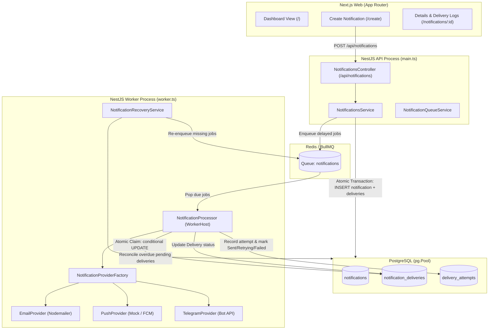
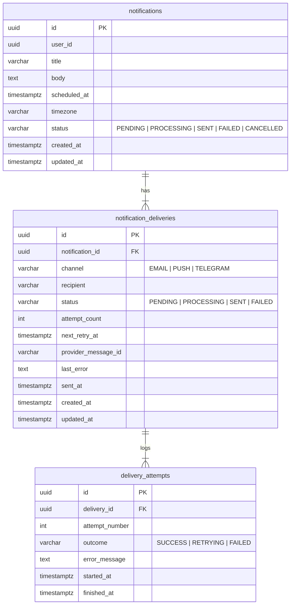

# Scheduled Notifications Proof-of-Concept (POC)

A production-grade Scheduled Notifications POC built on an existing **NestJS 12 backend** (native ESM, raw `pg` PostgreSQL, BullMQ, Redis) and **Next.js 16 frontend** (App Router, React 19, Tailwind CSS).

The system reliably schedules and dispatches notifications across three channels:
1. **Email** (SMTP via Nodemailer)
2. **Push Notifications** (Mock provider by default with receipt IDs, optional FCM support)
3. **Telegram** (Telegram Bot API)

---

## Architecture Overview



---

## Key Reliability & Architecture Highlights

### 1. PostgreSQL as the Single Source of Truth
- **Strictly No ORM**: Built using raw parameterized SQL queries with `pg.Pool` connection pooling and explicit transactions (`BEGIN`, `COMMIT`, `ROLLBACK`).
- **Atomic Creation**: Notifications and their channel-specific delivery records are inserted atomically in a single PostgreSQL transaction.
- **Independent Channels**: Each delivery channel operates independently. An email failure will never cause an already-delivered Telegram message to be resent.

### 2. Dual-Layer Duplicate Processing Prevention
- **Stable BullMQ Job IDs**: Jobs are enqueued with deterministic IDs (`delivery-${deliveryId}`).
- **Atomic Database Claiming**: Background workers claim deliveries using conditional SQL:
  ```sql
  UPDATE notification_deliveries
  SET status = 'PROCESSING', updated_at = NOW()
  WHERE id = $1 AND status IN ('PENDING', 'FAILED')
  RETURNING *;
  ```
  If another concurrent worker claimed or finished the delivery, the query returns 0 rows and the job is safely skipped.

### 3. Restart Recovery Mechanism
- **The PostgreSQL vs. Redis Gap**: Writes to PostgreSQL and job enqueues to Redis do not form a distributed atomic transaction. If Redis restarts or drops jobs during a network blip, or if a worker crashes mid-flight, a reconciliation gap exists.
- **Reconciliation Engine**: `NotificationRecoveryService` queries PostgreSQL on startup and every 30 seconds for overdue pending deliveries (`scheduled_at <= NOW()`) and re-enqueues missing jobs into BullMQ with `0ms` delay.

### 4. Bounded Exponential Backoff with Jitter
- Temporary failures (e.g., SMTP rate limit, Telegram API downtime) trigger retries up to **4 attempts**.
- Backoff delay: `delay = Math.min(300000, 5000 * 2^(attempt - 1) + jitter)`.
- If 4 attempts are exhausted, the delivery is marked permanently `FAILED`.

### 5. Multi-Channel Notification Providers
- **Email Provider**: Uses Nodemailer with SMTP credentials.
- **Telegram Provider**: Uses native `fetch` against `https://api.telegram.org/bot<TOKEN>/sendMessage`.
- **Push Provider**: Emits mock receipts (`mock-push-<timestamp>-<hash>`) by default. Clearly flagged as `MOCK PROVIDER` in both UI and logs. Optional FCM support when credentials are provided.

---

## Database Schema



- **Unique Constraint**: `(notification_id, channel, recipient)` on `notification_deliveries`.
- **Unique Constraint**: `(delivery_id, attempt_number)` on `delivery_attempts`.
- **Indexes**: `(scheduled_at, status)`, `(status, next_retry_at)`, and foreign key lookup indexes.

---

## Getting Started

### 1. Prerequisites
- Node.js (v20+ recommended)
- Docker & Docker Compose (for local PostgreSQL and Redis)
- pnpm (backend) and npm (frontend)

### 2. Start PostgreSQL & Redis Infrastructure
```bash
# Start local Postgres (port 5432) and Redis (port 6379)
docker compose up -d
```

### 3. Backend Setup (`/api`)
```bash
cd api

# Copy environment variables
cp .env.example .env

# Run database migrations
pnpm run db:migrate

# Run unit and integration tests (30 tests)
pnpm run test

# Start the NestJS API server (http://localhost:3000)
pnpm run start:dev

# (Optional) Run the background worker in a separate process:
pnpm run start:worker
```

### 4. Frontend Setup (`/web`)
```bash
cd web

# Copy environment variables
cp .env.example .env.local

# Start Next.js development server (http://localhost:3001 or 3000)
npm run dev
```

---

## REST API Specification

| Method | Endpoint | Description |
|---|---|---|
| `POST` | `/api/notifications` | Create and schedule a notification across channels |
| `GET` | `/api/notifications` | List notifications with status filter & pagination (`?status=PENDING&page=1&limit=10`) |
| `GET` | `/api/notifications/:id` | Get details and delivery summary for a notification |
| `PATCH` | `/api/notifications/:id` | Update title, body, or time of a pending notification |
| `POST` | `/api/notifications/:id/cancel` | Cancel an active pending notification |
| `POST` | `/api/notifications/:id/retry` | Re-enqueue and retry failed deliveries immediately |
| `GET` | `/api/notifications/:id/deliveries` | Get per-channel delivery statuses and attempt history |

### Example Payload: Create Notification
```json
POST /api/notifications
Content-Type: application/json

{
  "title": "Database Maintenance Notice",
  "body": "System update scheduled in 10 minutes. Please save your work.",
  "scheduled_at": "2026-10-30T10:00:00.000Z",
  "timezone": "America/New_York",
  "channels": [
    { "channel": "EMAIL", "recipient": "devops@company.com" },
    { "channel": "PUSH", "recipient": "device-token-abc" },
    { "channel": "TELEGRAM", "recipient": "123456789" }
  ]
}
```

---

## Known Limitations & Production Considerations

1. **At-Least-Once Delivery vs. Exactly-Once Delivery**:
   External providers (SMTP, Telegram, APNs/FCM) lack distributed 2-phase commit with internal databases. If an external provider receives and delivers a message, but the worker crashes right before updating the database, restart recovery or retry may redeliver the message. True exactly-once delivery across third-party communication providers is mathematically impossible without external idempotency key support on the provider's side.
2. **Transactional Outbox**:
   For extreme mission-critical durability, a formal Transactional Outbox pattern with CDC (e.g. Debezium) can replace direct Redis enqueuing. In this POC, the lightweight `NotificationRecoveryService` provides robust reconciliation without adding operational overhead.
3. **Authentication**:
   Per interview instructions, authentication is decoupled for this POC. The `user_id` column is ready to accept authenticated user UUIDs.

